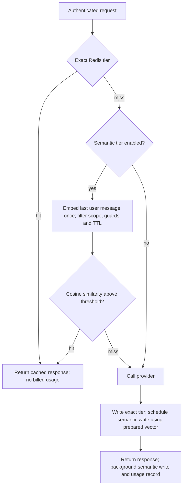

# Semantic cache

The embedding cache is a second, opt-in tier behind the exact-match Redis cache. It is disabled by default. Similarity alone does not establish equivalent meaning: the supplied fintech and PAWS datasets contain different-meaning pairs with very high cosine similarity. Number and contrast-token guards reduce some errors, but they do not eliminate them.

The default threshold is **0.9997357130050659**, tuned with Chroma's default 384-dimensional ONNX MiniLM embedder. This conservative shared threshold is the maximum of the two guarded dev thresholds. It does **not** achieve 98% precision on the held-out PAWS test set. Opting in accepts that cached responses may answer a different question.

## Architecture overview



Everything except the last user message's content must match exactly. `scope` hashes the caller fingerprint, provider, resolved model, cache version, and full request with just that content removed. System instructions, earlier turns, any trailing assistant messages, sampling parameters, output-token limit, experiment and user fields remain in scope. Requests without a user message bypass fuzzy lookup.

`num_key` hashes the sorted multiset of digit/decimal tokens after stripping dollar signs, commas and percent signs. `$5,000` and `5000` match; `5k` is not expanded. `neg_key` hashes the set of tokens present from the documented `CONTRAST_TOKENS` heuristic in [embedding_cache.py](../src/cache/embedding_cache.py). Both hashes are mandatory equality filters in Chroma, together with scope and tenant. Query time filters `created_at >= now - ttl_s`. Similarity is `1 - cosine distance`.

Exact hits retain `x-gateway-cache: hit` in the JSON body. Semantic hits return `semantic-hit` plus `x-gateway-cache-similarity`, rounded to four decimal places, as JSON body fields. Provider responses report `miss` when either tier is enabled, otherwise `disabled`. Both hit types return zero billed cost and skip UsageTracker and upstream token/cost counters. Semantic hits do not populate Redis; successful provider calls write each enabled tier.

`llm_gateway_cache_total` retains exact-tier `result="hit"` and `"miss"`. The separate `llm_gateway_semantic_cache_total` uses the same results for semantic attempts after an exact miss. Runtime embedding or storage errors log a warning, increment `llm_gateway_semantic_cache_errors_total`, and fall through to the provider. Embedding and querying run through `asyncio.to_thread`; writes use FastAPI background tasks.

## Prerequisites & setup

```sh
pip install -e '.[dev,semantic,bench]'
SEMANTIC_CACHE_ENABLED=true API_KEYS=your-key uvicorn src.api.main:app
```

The base install, Docker image, compose setup and offline quickstart need no Chroma import. To enable the tier, install the optional `semantic` extra and provision the default embedder locally before offline startup. Enabled startup constructs the cache, then calls `warm()` for one dummy embedding. Missing optional imports produce the install-extra hint; unavailable weights or storage initialization failures surface their original errors. Runtime failures remain cache misses.

Reproduce the measurements from the repository root:

```sh
PYTHONPATH=. .venv/bin/python bench/tune_threshold.py
FAKE_UPSTREAM_LATENCY_MS=200 PYTHONPATH=. .venv/bin/python bench/cost_latency.py
# Latency is supplied by this benchmark's in-process provider.
```

The tuning script embeds both complete CSVs, uses a seed-0 stratified 50/50 split, and evaluates a 0.001 threshold grid plus observed dev similarities. It selects the lowest evaluated threshold with dev precision at least 0.98, or explicitly reports failure and chooses maximum dev precision. Precision with no predictions is encoded as zero, not evidence of safety. Derived vector archives are ignored by git; `--reuse-vectors` reuses those local archives. JSON and PNG results are kept under [bench/results](../bench/results/).

## Config

| Environment variable | Default |
|---|---|
| `SEMANTIC_CACHE_ENABLED` | `false` |
| `SEMANTIC_CACHE_THRESHOLD` | `0.9997357130050659` |
| `SEMANTIC_CACHE_PATH` | `./.semantic_cache` |
| `CACHE_TTL_S` (both tiers) | `3600` |
| `SEMANTIC_CACHE_MAX_ENTRIES_PER_TENANT` | `10000` |
| `CACHE_VERSION` | `1` |

`CACHE_ENABLED` controls the existing Redis tier independently. The semantic flag controls only the embedding tier. The historical `SemanticCache` class in `src/cache/semantic_cache.py` remains the exact-match implementation.

## The storage policy

No prompt text is stored in Chroma. Each entry stores an opaque id, an embedding and metadata: scope hash, number hash, contrast-token hash, tenant fingerprint, creation epoch. Cached response JSON is stored separately as a document, fetched only on lookup; housekeeping uses id-only reads, with creation order encoded in ids. Responses themselves can contain sensitive content, including text echoed by a provider. Embeddings are still sensitive and can leak content; protect the directory and its backups accordingly.

Semantic tenant identity uses the audit `key_fingerprint()` helper (`sha256(api_key)[:12]`); exact-cache scopes retain `sha256(api_key)[:16]`. Raw API keys are never stored in either cache. Query scope and metadata filters enforce isolation; the cap is per tenant. Housekeeping purges expired entries and evicts the writing tenant's oldest entries in one store call every 100 writes per process, so the cap is approximate. TTL expiration filters hits immediately. Only housekeeping is locked; lookups and adds run without the lock.

The three invalidation methods are TTL expiry, authenticated deletion, and a cache-version bump. `DELETE /v1/cache` uses the same `X-API-Key` auth and rate-limit dependency as completions, clears enabled tiers concurrently, scans only `llm_cache:{fingerprint}:*` Redis keys with one `UNLINK` per page, and deletes only matching semantic tenant metadata. It returns `{"exact": <deleted count>, "semantic": <deleted count>}`. Storage outages can produce partial counts; warnings and the semantic error counter expose failures. Changing `CACHE_VERSION` and restarting switches both tiers to a fresh namespace; old entries remain until TTL cleanup or explicit deletion. Version `1` preserves the original exact-cache key payload.

A local Chroma `PersistentClient` gives each replica its own semantic cache under k8s/helm, unlike the shared Redis tier. Deletion clears Redis plus the semantic store of the serving replica only. Route invalidation to each replica or bump the version across all replicas when fleet-wide invalidation is required. Use a separate local data path per replica.

## Call cost

Savings are avoided provider calls **on top of the exact tier**. Local embedding and storage have compute and disk costs; every exact miss incurs embedding overhead when the semantic tier is enabled, including provider misses. A vector is computed once and reused on the subsequent write. Exact hits avoid that overhead.

The [threshold results](../bench/results/threshold.json) use 50 fintech pairs (25 dev / 25 test) and 2,000 PAWS pairs (1,000 / 1,000). Guards block 17 fintech pairs and 28 PAWS pairs before similarity. At each dataset's guarded dev threshold, held-out results are:

| Dataset | Threshold | Guards | Precision | Recall | False-positive rate |
|---|---:|---|---:|---:|---:|
| fintech | 0.878 | with | 75.00% | 50.00% | 15.38% |
| fintech | 0.878 | without | 46.15% | 50.00% | 53.85% |
| PAWS | 0.9997357130050659 | with | 66.67% | 0.8772% | 0.3676% |
| PAWS | 0.9997357130050659 | without | 66.67% | 0.8772% | 0.3676% |

Without guards, no evaluated fintech dev threshold reaches 98% precision; maximum precision is 66.67% at 0.925. Both guarded dev selections reach 100% precision on very few predicted positives (five fintech, three PAWS); the held-out results show how poorly that guarantee generalizes. At the shared runtime threshold, fintech predicts no matches (zero recall; precision is undefined and encoded as zero), while PAWS retains the results above: four true positives and two false positives. These measurements support keeping the tier opt-in and do not establish safe equivalence.

The [cost/latency replay](../bench/results/cost_latency.json) sends 700 requests from all 50 fintech pairs plus the first 300 PAWS pairs, with 200 ms fake-provider latency. Each pair has its own exact system scope so a hit can be attributed to its pair label; there is no extra exact-repeat traffic. The default embedder is warmed before timing; TestClient timings include lookup, provider, response handling and completion of background cache writes. The provider returns 100 prompt and 50 completion tokens for `gpt-4o-mini`; dollars use `request_cost_usd` and the repository's price table. **Hit rate depends on the workload.**

| Config | Provider calls | Exact hits | Semantic hits | False semantic hits | Dollars saved | Hit p50 / p95 ms | Miss p50 / p95 ms |
|---|---:|---:|---:|---:|---:|---:|---:|
| no_cache | 700 | 0 | 0 | 0 | $0.000000 | n/a | 205.98 / 210.22 |
| exact_only | 699 | 1 | 0 | 0 | $0.000045 | 2.64 / 2.64 | 205.72 / 211.23 |
| exact_semantic | 699 | 1 | 0 | 0 | $0.000045 | 2.35 / 2.35 | 297.91 / 382.76 |

Exact hit rate is 0.1429% in both cache configurations; the semantic hit rate is 0.00%. Incremental semantic savings are **$0.000000**: this replay avoids no additional provider calls at the shared threshold. Median miss latency increases by 92.20 ms compared with exact-only caching. Zero observed false semantic hits here comes with zero semantic hits, so it is not evidence of equivalence. Hit percentiles describe just one exact hit per cache configuration, not semantic-hit performance. The held-out PAWS false-positive rate above remains the relevant observed risk. Dollar figures exclude local compute, disk and operational costs.
